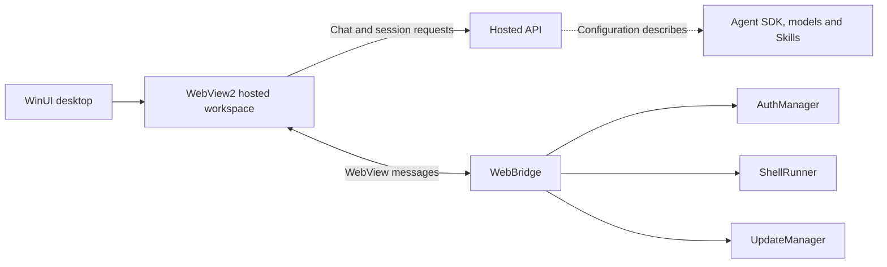

# E1pi reverse-engineering findings

LedgerPilot design reference. Scope: installed E1pi Windows assembly 1.0.17.0, cached login JavaScript, and inline JavaScript from a signed-in browser snapshot. This is a documentation-only contribution.

## Traced behavior

| Area | Observed path | Evidence reference |
| --- | --- | --- |
| Startup | `MainWindow.InitWebAsync` initializes WebView2 and installs the bridge before navigation. | Managed trace, async method `0x0600011f` |
| Browser sign-in | Client reads auth configuration, uses MSAL, and calls `/api/session-cookie`. The Microsoft 365 branch requests separate Graph and E1pi API scopes. | Cached login script 4, lines 29–108 and Microsoft 365 branch from line 111 |
| Native sign-in | `AuthManager.GetTokensAsync` and `AcquireAsync` obtain tokens. `WebBridge.PushTokensAsync` can pass them to the WebView. The installed MSAL helper uses Windows DPAPI CurrentUser for its native cache. | Managed trace and installed cache-helper inspection |
| Chat | Client sends message, model and system prompt to `POST /api/chat`. Optional fields carry session, private-mode, Microsoft Graph and device context. | Authenticated inline script 23, lines 1702–1758 |
| Run controls | Client has reconnect, steer, interrupt and abort paths. The client references `/api/chat/respond` for a paused browser tool. | Inline script 18, lines 304 and 437. Inline script 23, lines 1706 and 2791–2802 |
| Skills and approvals | Client reads a configured prompt via `/api/read-skill` and references external approval, permission and browser-tool modules. | Inline script 23, lines 20–23 and 90–104 |
| Streamed reports | The `pipe_html` renderer appends complete script blocks marked `data-live` from streamed content. | Inline script 18, lines 379–403 |
| Windows bridge | `WebBridge.OnMessage` dispatches authentication, shell and update messages. The shell branch calls `ShellRunner.RunAsync` and returns results asynchronously. The updater calls `UpdateManager.InstallAsync`. | Managed trace, async dispatcher `0x0600012b` |

## Evidence and limits

- Fresh REA managed metadata inspection classified the installed DLL as x64 modern .NET CIL. SHA-256: `9d690034e1de29f1cc4936c83a3e0e61cbadaec77172d5f79d5ceede781c5042`. Evidence: `ev_de9e4932d93d2f12535acbcab0b2a2fbba304eeda26bfd42657b5a79ae830c85`.
- Retained managed member evidence decoded 49 types, 307 methods and 1,499 static call references. Evidence: `ev_3db01f58d4701532180b5f1b6ff2873fe306fbdae387c10cb882a79249589ee8`. Method tokens apply to this DLL build.
- Retained browser source analysis parsed 28 inline scripts with zero parse failures and partial semantic coverage. Evidence: `ev_e589173aeae5290ac5f691b081e7f8a9ea17268a1cbf9ee774c31162b7e6b63a`. Evidence IDs identify records in the local analysis archive.
- Supplied configuration describes a Node server, Claude Agent SDK, model providers, Skills and Tally connections. The backend, external approval modules and business Skill bodies remain outside the recovered artifacts. Server authorization, model routing, approval enforcement, and private-session isolation remain unverified.
- The signed-in workspace was observed through browser UI. REA could not attach to the browser debugging endpoint. Shell execution, installer launches and production workflow effects were outside runtime verification.

## LedgerPilot design decisions

Use typed read-only accounting operations, server-side company authorization, and approval tied to the exact reminder revision. Render reports as structured data. Keep the connector interface restricted to named operations and record approvals and delivery attempts in the audit trail. These are proposed LedgerPilot controls derived from the observed boundaries.
